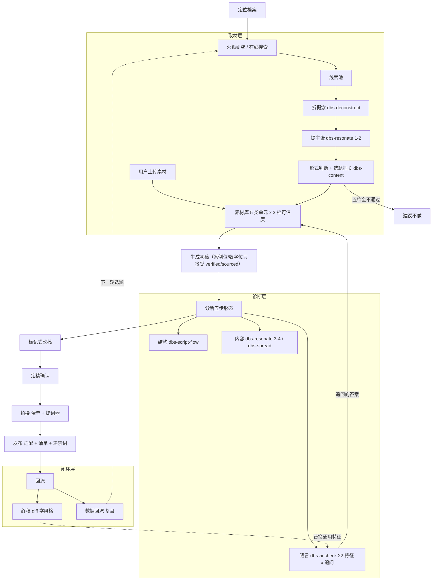

# 工作台重构（DBS 内核路线）

Feature Name: content-workbench-upgrade
Updated: 2026-09-18

## Description

把工作台从「生成成品 → 验收成品」改成「给一个初稿 → 陪用户改」。诊断全部按 DBS（dontbesilent）开源技能共用的**五步形态**重建：接收 → 分维度诊断 → 出报告 → **问要不要改** → 确认后标记式改稿。内容层从「生成后审查」前移成「生成前取材」。平台收敛到抖音与视频号。

## 主线

> 判据不再由我们发明。它有两个来源：**DBS 的可溯源内核**，与**用户自己的终稿回流**。

现状的根本矛盾不是规则写得不好，是**判据用错了对象**：

```
现状：初稿 → 用成品标准验收 → 打回 → 自动重写 → 仍不合格 → 标 needs_revision → 用户改不动
                      ↑
        生成端「要写足字数」与审查端「别啰嗦」在此对撞

改后：取材（把料备齐）→ 初稿（允许不完美）→ 诊断（只指出）→ 追问（问出本意）→ 用户确认才改
```

## 三层判定模型

继承 `judgment-layering`，两处修正。

| 层 | 依据来源 | 用法 | 拦停 |
|---|---|---|---|
| 结构 | 我们指定 + `dbs-script-flow` | 闸门 + 风险等级报告 | 只拦「根本没做出来」 |
| 语言 | `dbs-ai-check` 22 特征 × 追问 → 逐步由回流替换 | 提醒，按文本顺序逐处 | 不拦停 |
| 内容 | 素材可信度（客观） + `dbs-content`/`resonate`/`spread`（报告） | 报告 + 生成前把关 | 只在**选题阶段**拦停 |

**修正 1**：语言层不设类别数量上限，也不做归并。`dbs-ai-check` 有 22 个特征且不矛盾，因为每条都配「背后意图 + 追问」。真正防止清单爆炸的机制是**一次只呈现一条 + 按文本顺序**，不是减少条目。

**修正 2**：内容层从「不判」改成「前置取材 + 选题把关 + 可溯源判据」。内容层唯一的新闸门是客观的：

> 案例位 / 数字位**能否溯源到一条 `verified` 或 `sourced` 素材**。

这条是确定性的，不是审美。它替代了原来互相打架的 `vague_case` × `case_claim` × 字数下限三者。

### 闸门最终清单

| 闸门 | 判据 | 来源 |
|---|---|---|
| 无正文 | 正文为空 | 原有 |
| 串台 | 正文出现其他平台名 | 原有 `platform_mixup` |
| 格式泄漏 | Markdown 标题/加粗/结构占位/占位说明/其他平台建议行 | 原有 `format_leak` |
| 两平台同一篇 | 抖音与视频号正文重复（jaccard ≥ 0.42 或 containment ≥ 0.7） | 原有 `same_essay`，平台对从 6 对降到 1 对 |
| **素材不可溯源** | 案例位或数字位使用的素材不是 `verified`/`sourced`，或正文出现无来源的具体案例与数字 | **新增** |

`self_intro`（自我介绍）降为提醒。`length_severe` 降为提醒，不触发自动重写。

## Architecture



**读图要点**：`D2 → M` 这条边（追问答案回写素材）是关键回路——改稿的副产品是新素材，稿子越改素材越厚，下一轮初稿质量越高。

## Components and Interfaces

### 服务端

沿用单文件路由 `server/index.mjs` + `ip_collections` 存储（`server/mysql.mjs`），JSON MVP 回退不变。

1. **`server/draft-checks.mjs`**
   - `writingIssues()` 拆成 `gateIssues()`（上表 5 条）、`structureIssues()`、`languageIssues()`、`contentIssues()`。
   - 语言层条目结构从 `{code, message}` 改为 `{code, label, severity, quote, note, intent, followup}`。
   - `scanGeneratedBody` / `scanGeneratedBodies` 的 `failed` 只依据 `gateIssues()`。
   - 删除 7 类归并相关代码（`reminderCategories` 与相应措辞），改为细粒度特征 + 追问。
   - `checkQuality` 保留 `judgment-layering` Requirement 5 的守卫修复。

2. **`server/draft-writing.mjs`**
   - 平台集合从 4 平台收敛为抖音 + 视频号。
   - 写作提示词接收取材产出（主张、素材清单、形式判断），并约束案例位与数字位只使用 `verified`/`sourced` 素材。
   - 诊断报告改为按文本顺序产出，提示词明确「不按特征分类」。
   - 新增追问提示词：一处一个问题，取得意图后再改。
   - 标记式改稿的提示词与解析：产出保留原文对比的改稿结果 + 改动清单。

3. **`server/index.mjs`**
   - 素材路由新增 `material_trust`、`unit_type` 的读写与筛选参数。
   - 新增「火狐条目转素材」路由：`sourced` + 来源链接 + 关键词来源标记。
   - 新增「拆概念 / 提主张 / 形式判断 / 选题把关」路由，产出落素材库。
   - 新增「追问答案回写素材」路由。
   - 新增诊断条目读写：诊断结果按文本顺序存 `{items: [...]}`，兼容历史 `checks`。
   - 新增标记式改稿路由（或在既有改写路由上增加模式）。

4. **迁移脚本**：`material_kind` → `unit_type` 映射，可重入，不删除记录。

### 客户端

`src/main.tsx`、`src/styles.css`、`src/shared/types.ts`

1. 取材层界面：拆概念、提主张、形式判断、选题把关四个环节，按单步路由呈现。
2. 素材库：新增可信度筛选与标签、`unit_type` 筛选；保留 `material_kind` 展示。
3. 诊断面板：改成**一次一条 + 按文本顺序**，就地展示原文引用、说明、严重度、追问输入框。
4. 报告末尾新增「要不要改」入口；确认后进入标记式改稿视图，含改动清单。
5. 历史小红书/公众号草稿只读保留。

### 类型

`src/shared/types.ts` 新增：`MaterialTrust`、`UnitType`、`DiagnosisItem`、`DiagnosisReport`、`MarkupRewrite`。

## 数据模型

### 素材

```
material_trust: 'verified' | 'sourced' | 'derived'   // 新增，缺省 verified
unit_type:      'QST' | 'CON' | 'OPI' | 'CAS' | 'SOL' | null   // 新增
material_kind:  保留（历史兼容 + 来源容器识别），不再作为装配依据
source_refs:    保留，sourced 素材必须带来源链接
```

迁移映射：`quote` → `OPI`、`hotspot` → `QST`、`experience` → `CAS`、`insight` → `CON` 或 `CAS`（无法判定留空待人工）、`article` → 不生成 `unit_type`。

### 诊断条目

```
DiagnosisItem {
  code, layer: 'structure' | 'language' | 'content',
  label, severity: 'high' | 'medium' | 'low',
  quote: { start, end, text },   // 文本顺序定位
  note,                           // 一句人话说明
  intent,                         // 背后意图（可溯源到 DBS 特征）
  followup                        // 追问，一条一个问题
}
DiagnosisReport { items: DiagnosisItem[] }   // 按 quote.start 升序
```

历史 `checks` 数据保持可展示，新增字段缺失时用默认值。

### 平台基座（抖音 / 视频号）

| | 抖音 | 视频号 |
|---|---|---|
| 观众心理 | 划到就走，前 3 秒决定生死 | 熟人半熟人，看你这个人靠不靠谱 |
| 开头 | 直接冲突 / 反常识 | 可直接给结论，但「我」要在场 |
| 节奏 | 短句、快、信息密度高 | 可稍慢、可讲过程 |
| 结尾 | 引导评论 / 站队 | 引导转发 / 私信，少喊话 |
| 失败形态 | 平、慢、没冲突 | 像广告、不像人说话 |

## 关键决策与理由

| 决策 | 理由 | 否决的方案 |
|---|---|---|
| 内容层前移成取材 | 价值取决于素材、认知落差、定位，三样都在稿子外；编造的根子是简报里没有真素材 | 把内容层做成生成后的审查（判不了，只能靠发明审美，必然打架） |
| 加素材可信度三档 | 让内容层有**客观**判据：案例位能否溯源；同时把「禁止编造」从提示词约束变成结构约束 | 只分两档（外部资料会和模型编的内容混在一起） |
| 语言层不设数量上限 | DBS 22 个特征不矛盾，关键在每条配「背后意图 + 追问」 | 归并成 7 类（丢掉每类的追问差异） |
| 诊断按文本顺序 | 按特征分类会让同一句在多个分类里重复出现，是「同一问题显示多次」的病根 | 按特征分类呈现 |
| `length_severe` 降为提醒 | 它是「初稿没写完」的信号，不是「不合格」；料就那么多，自动重写没意义 | 留在闸门、同样触发重写 |
| 平台收敛到两个 | `same_essay` 从 6 对降到 1 对；长度目标简化；诊断注意力集中 | 维持 4 平台（摊薄注意力，判据互相干扰） |
| 标记式改稿 + 版本历史并存 | 标记式是改稿时的**交互**，版本历史是底层**存档**，分工不冲突 | 只保留版本历史（用户看不见改了什么） |
| 追问答案回写素材 | 让改稿反过来充实素材库，形成复利 | 答案只用于本次改写（丢掉最有价值的副产品） |
| 成本不设上限 | 一期自用，先跑出效果 | 先做成本优化（会拖慢验证） |

## 与 judgment-layering 的关系

- **取代** Requirement 2（语言层 14 个判据归并为 7 类）。归并设计与本特性的「细粒度特征 + 追问」直接冲突，`reminderCategories` 与相关措辞需撤回。
- **继续有效** Requirement 1（闸门收敛，本特性在其基础上增删一条）、Requirement 5（质量门无守卫修复，已完成）、Requirement 6（向后兼容）。
- **Requirement 3、4**（提醒给替换对、一次一条）部分继承：本特性改为「一处一个追问」，但「一次只呈现一条」的原则保留并强化到全部诊断。

## 不在本期

- 商业诊断类 DBS 技能（见 requirements.md Out of Scope）。
- 小红书与公众号的新稿生成。
- 成本与配额优化。
- 内容层判「案例数字是否真实」：只判能否溯源。
